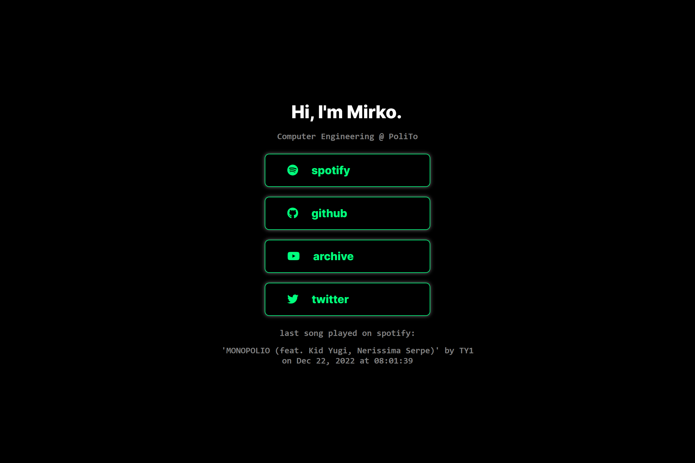

# Personal static website

## Configurazione connessione Spotify
Questa guida spiega come configurare l'integrazione di Spotify per il tuo sito statico in modo sicuro, evitando che i token vengano revocati o esposti pubblicamente.

### Architettura micro-proxy
Per un sito statico su GitHub Pages, l'approccio standard e raccomandato è usare un micro-proxy serverless gratuito (es. Cloudflare Worker o Vercel):

```
Browser del visitatore (GitHub Pages)
         |
         | GET /
         v
   spoti.js
         |
         | fetch('https://tua-api.workers.dev')  [Zero credenziali esposte]
         v
Cloudflare Worker / Vercel API
  - Conserva in sicurezza CLIENT_ID, CLIENT_SECRET, REFRESH_TOKEN
  - Effettua la richiesta a Spotify
  - Mette in cache la risposta (30s) per evitare rate limit
         |
         v
   Spotify Web API
```

### Generare un nuovo Refresh Token Spotify

1. Vai sulla tua [Spotify Developer Dashboard](https://developer.spotify.com/dashboard) e apri la tua App (o creane una nuova).
2. Nelle impostazioni dell'app (**Settings**):
   - Aggiungi nei **Redirect URIs**: `http://localhost:8888/callback`
   - Clicca **Save**.
   - Copia il **Client ID** e il **Client Secret**.
3. Esegui lo script presente nella cartella `tools`:
   ```bash
   python tools/get_spotify_token.py
   ```
4. Lo script ti chiederà il `Client ID` e il `Client Secret`, aprirà il browser per autorizzare l'accesso e stamperà nel terminale il tuo nuovo **`REFRESH_TOKEN`**.

### Deploy del proxy

Puoi scegliere Cloudflare Workers:

1. Crea un account gratuito su [Cloudflare](https://dash.cloudflare.com/) (se non ne hai già uno).
2. Nel menu a sinistra vai su **Workers & Pages** -> **Create application** -> **Create Worker**.
3. Assegna un nome (es. `spotify-status`) e clicca su **Deploy**.
4. Clicca su **Edit code**, incolla il contenuto del file [`worker/worker.js`](worker/worker.js) e clicca **Deploy**.
5. Vai nelle impostazioni del Worker -> **Settings** -> **Variables and Secrets** e aggiungi le 3 variabili come secret:
   - `SPOTIFY_CLIENT_ID`
   - `SPOTIFY_CLIENT_SECRET`
   - `SPOTIFY_REFRESH_TOKEN`
6. Copia l'URL del tuo worker (es. `https://spotify-status.tuonome.workers.dev`).

### Collega l'URL al tuo sito
Apri il file [`spoti.js`](spoti.js) e imposta la costante all'inizio del file:

```javascript
const SPOTIFY_API_URL = 'https://spotify-status.tuonome.workers.dev';
```

Fatto!
